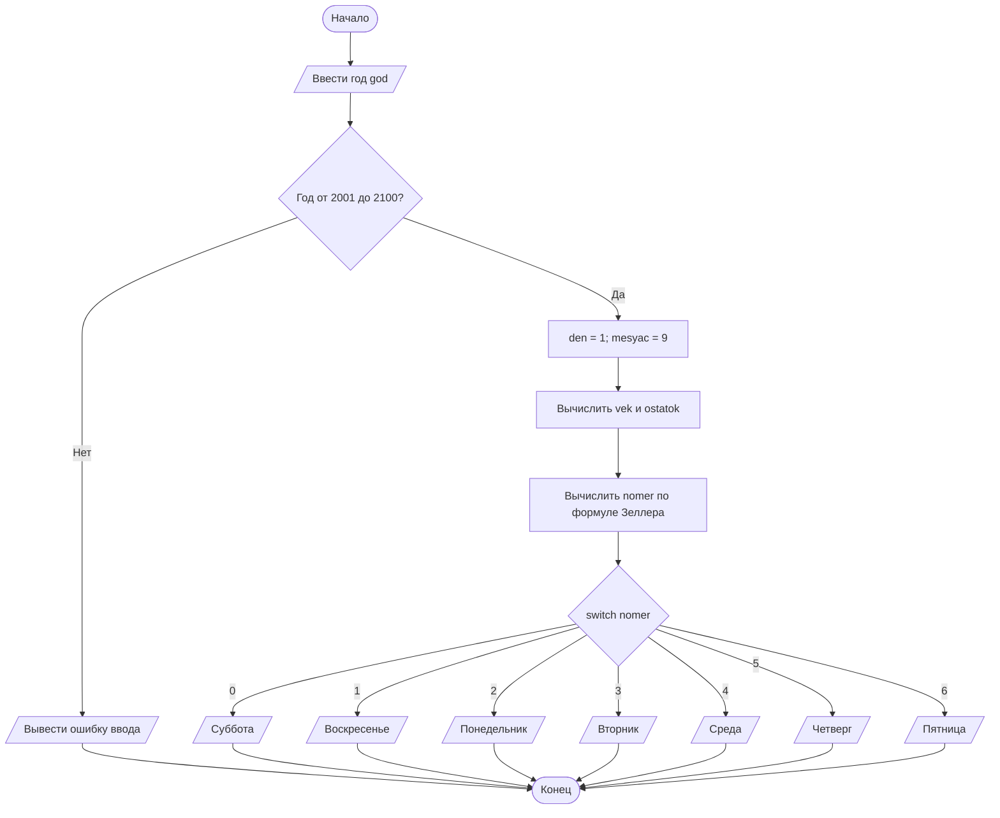

# Лабораторная работа № 7 — Задание 3, вариант 8

## Условие задачи

Определить, на какой день недели приходится **1 сентября** произвольно заданного года **XXI века (2001–2100)**. Для выбора названия дня недели использовать оператор `switch`.

## 1. Алгоритм и блок-схема

### Алгоритм

1. Начало программы.
2. Объявить целочисленные переменные `god`, `den`, `mesyac`, `vek`, `ostatok`, `nomer`.
3. Ввести год `god` с клавиатуры.
4. Проверить, что год находится в пределах от 2001 до 2100. Если нет — вывести сообщение об ошибке и завершить программу.
5. Установить день `den = 1` и месяц `mesyac = 9` (1 сентября).
6. Вычислить номер века `vek = god / 100` и остаток года `ostatok = god % 100`.
7. По формуле Зеллера определить номер дня недели `nomer`. Номер 0 означает субботу, 1 — воскресенье, 2 — понедельник и так далее до 6 — пятницы.
8. С помощью `switch (nomer)` вывести соответствующий день недели.
9. Конец программы.

### Блок-схема



## 2. Реализация программы

Программа написана на языке **C** для **Microsoft Visual Studio**. Для вывода русского текста используется `SetConsoleOutputCP(65001)`. Файл нужно сохранить в кодировке UTF-8.

```c
#define _CRT_SECURE_NO_WARNINGS
#include <stdio.h>
#include <windows.h>

int main(void)
{
    int god, den, mesyac, vek, ostatok, nomer;
    SetConsoleOutputCP(65001);
    printf("Введите год XXI века (2001-2100): ");
    if (scanf("%d", &god) != 1 || god < 2001 || god > 2100) {
        printf("Ошибка ввода года.\n");
        return 1;
    }
    den = 1;
    mesyac = 9;
    /* Алгоритм Зеллера: 0 - суббота, 1 - воскресенье, ... 6 - пятница */
    vek = god / 100;
    ostatok = god % 100;
    nomer = (den + 13 * (mesyac + 1) / 5 + ostatok + ostatok / 4 + vek / 4 + 5 * vek) % 7;
    printf("1 сентября %d года - ", god);
    switch (nomer) {
    case 0: printf("суббота\n"); break;
    case 1: printf("воскресенье\n"); break;
    case 2: printf("понедельник\n"); break;
    case 3: printf("вторник\n"); break;
    case 4: printf("среда\n"); break;
    case 5: printf("четверг\n"); break;
    case 6: printf("пятница\n"); break;
    }
    return 0;
}
```

**Объяснение:** `scanf` считывает год, `if` проверяет допустимость ввода, арифметические операции определяют день недели, а `switch` выбирает нужную надпись. `break` завершает соответствующую ветку `switch`.

## 3. Результат работы программы

### Контрольный пример 1

**Ввод:** `2024`

```text
Введите год XXI века (2001-2100): 2024
1 сентября 2024 года - воскресенье
```

### Контрольный пример 2

**Ввод:** `2025`

```text
Введите год XXI века (2001-2100): 2025
1 сентября 2025 года - понедельник
```

### Контрольный пример 3

**Ввод:** `2026`

```text
Введите год XXI века (2001-2100): 2026
1 сентября 2026 года - вторник
```

### Контрольный пример 4 — неверный год

**Ввод:** `1999`

```text
Введите год XXI века (2001-2100): 1999
Ошибка ввода года.
```

**Вывод:** программа определяет день недели для 1 сентября любого года XXI века, используя вычисление номера дня и оператор `switch`.

## 4. Информация о разработчике

**Жаворонков Богдан, бТИИ-262**
